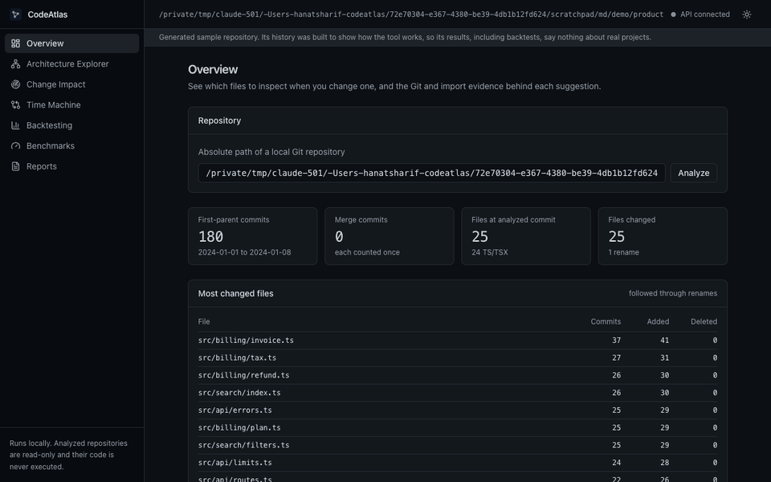
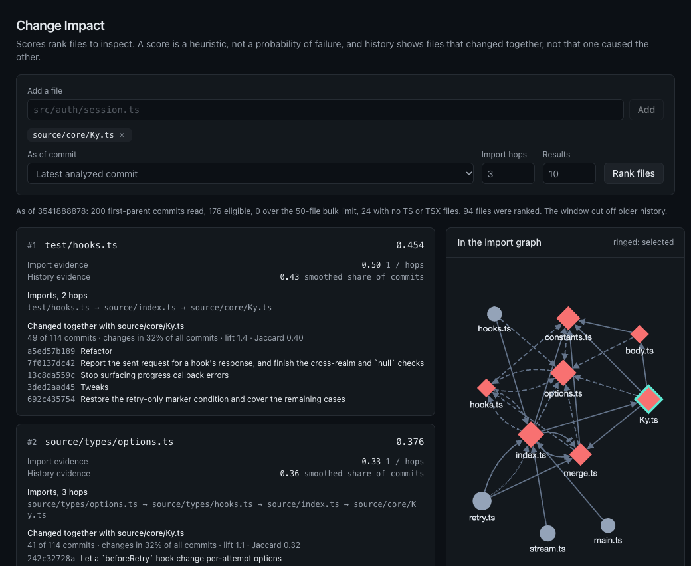
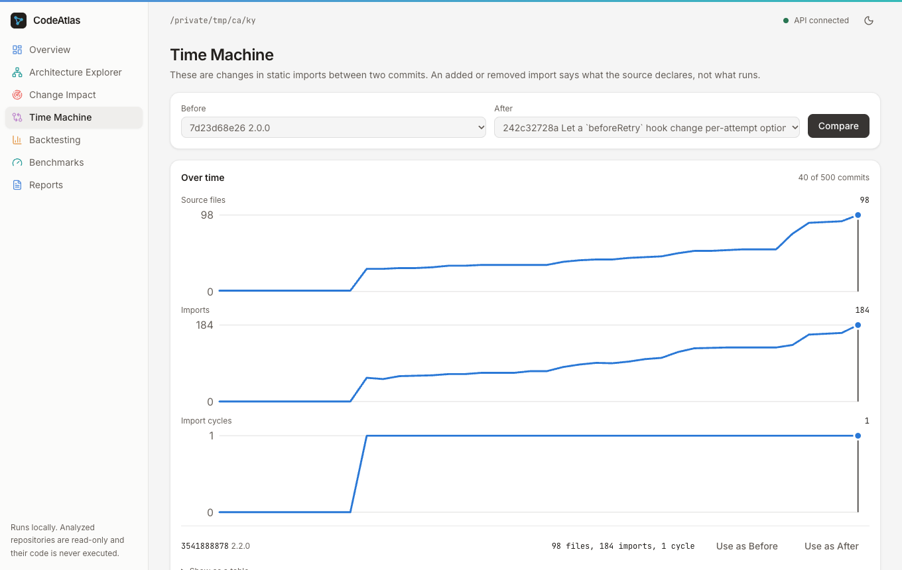
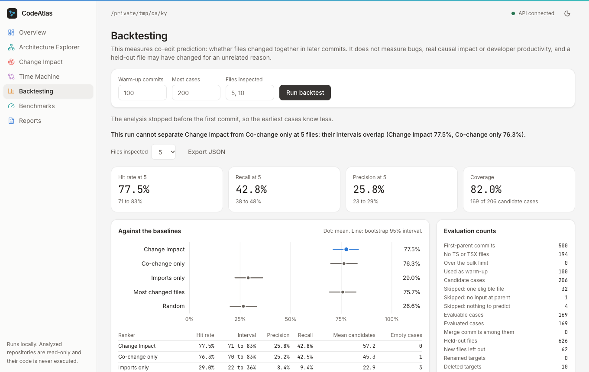
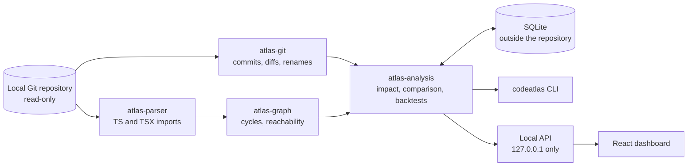
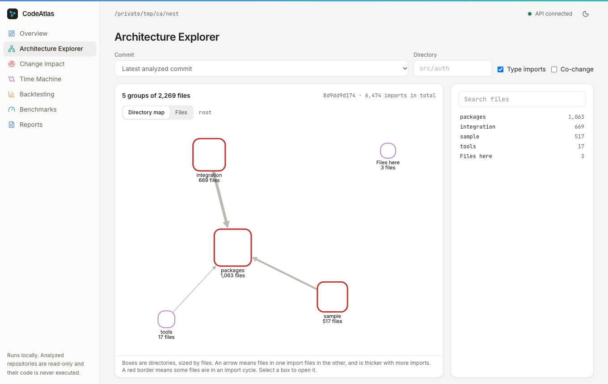

# CodeAtlas

**Before you change a TypeScript file, find out what else usually has to change with it.**

CodeAtlas reads a local Git repository's history and imports, then ranks the files you are most likely to need to touch, with the commits and import chains behind each result. It also shows how the architecture changed between any two commits, and it tests its own rankings against later commits so that you can see how far to trust them.





- **Change Impact:** pick a file and see what tends to change with it, and why.
- **Time Machine:** compare two commits for added and removed imports, cycles and renames, with charts of how the graph grew.
- **Architecture Explorer:** browse the import graph at any commit.
- **Backtesting:** measure the rankings on your own repository, against baselines, with no look-ahead.
- **Reports:** save one self-contained HTML or JSON file with provenance.

It runs entirely on your machine: no accounts, cloud services, paid APIs, LLMs or telemetry. Repositories are read-only and treated as untrusted, and their code, hooks and scripts never run.

**It supports TypeScript and TSX only.** Other files count towards history but get no analysis.

## Does it work?

Measured on six open-source projects that were set aside before the ranking was designed, and scored once:

| Share of commits where the top 5 files include one that really changed | Hit rate |
|---|---:|
| CodeAtlas | **46%** |
| Files that change most often | 20% |
| Random | 5% |

It beat the baseline on all six, though on one the margin is within the error bars. [docs/evaluation.md](docs/evaluation.md) has the method, every figure and the known biases. This measures which files change together. It does not measure bugs, causes or productivity, and a score is a ranking, not a probability of failure.

| | |
|---|---|
|  |  |

## How it works



The Rust engine works without the dashboard, and the dashboard contains no analysis logic. [docs/architecture.md](docs/architecture.md) has the details.

Large repositories open on a directory map, shown here on `nestjs/nest`:



## Try it

You need [Rust](https://rustup.rs), Node.js 20.16 or newer, and a C compiler. pnpm is optional.

```bash
git clone https://github.com/Hanart-prog/codeatlas
cd codeatlas
make demo
```

That builds everything, generates a sample repository, analyzes and backtests it, and prints a local address to open. The first build can take a few minutes. It needs no network once dependencies are fetched. The sample is generated, so its numbers show how the tool works and say nothing about real projects.

For your own repository, run `make build` and `target/release/codeatlas serve`, open http://127.0.0.1:4317, enter the repository's full path and choose Analyze.

Or use the command line:

```bash
alias codeatlas="$PWD/target/release/codeatlas"

codeatlas analyze /path/to/repo
codeatlas impact /path/to/repo --file src/some/file.ts
codeatlas report /path/to/repo --output report.html
```

Paths given to `--file` start at the repository root.

## How fast is it?

Measured on an Apple M3 Pro, as the median of 5 runs, reading the newest 500 commits at most:

| Repository | TS files | First analysis | 20 new commits |
|---|---:|---:|---:|
| sindresorhus/ky | 98 | 0.43s | 0.17s |
| colinhacks/zod | 515 | 0.97s | 0.15s |
| nestjs/nest | 2,269 | 1.32s | 0.14s |

Cached results are checked against a full reindex on every run. [docs/benchmarks.md](docs/benchmarks.md) has the method, memory, queries and limits, and the dashboard shows the same results.

## Requirements

- Rust, from [rustup](https://rustup.rs). `rust-toolchain.toml` pins the version.
- Node.js 20.16 or newer.
- pnpm 10. Optional: without it, the Makefile runs the pinned version through `npx`.
- A C compiler for the bundled SQLite.

## Development

```bash
make setup   # fetch Rust and frontend dependencies
make dev     # API on 127.0.0.1:4317, dashboard with live reload on http://127.0.0.1:5173
```

| Command | Purpose |
|---|---|
| `make check` | rustfmt, clippy with warnings denied, ESLint, TypeScript |
| `make test` | All Rust and frontend tests |
| `make build` | Release binary and production frontend |
| `make demo` | Build, then analyze and serve a generated repository |
| `make bench` | Measure generated and public repositories; needs the network |
| `make e2e` | Browser tests; `PW_CHANNEL=chrome make e2e` uses local Chrome |
| `make types` | Regenerate frontend types from the Rust DTOs |
| `make verify REPO=/path/to/clone` | Recheck imports, comparisons and backtests independently on a real repository |
| `make fixture DIR=/empty/dir` | Generate the deterministic fixture repository |

Open the dashboard and enter a repository path, or use the CLI. After `make build`, `codeatlas serve` run from this folder also serves the dashboard at http://127.0.0.1:4317.

## CLI

```bash
codeatlas analyze /path/to/repo --ref HEAD --history 500
codeatlas overview /path/to/repo --format json
codeatlas graph /path/to/repo --ref <commit> --directory src --format json
codeatlas graph /path/to/repo --by-directory
codeatlas impact /path/to/repo --ref <commit> --file src/auth/session.ts --top 10
codeatlas compare /path/to/repo --base <commit> --target <commit> --format json
codeatlas timeline /path/to/repo --points 40
codeatlas backtest /path/to/repo --warmup 100 --max-cases 200 --top-k 5,10 --format json
codeatlas report /path/to/repo --output report.html --format html
codeatlas serve /path/to/repo --port 4317
codeatlas demo
curl http://127.0.0.1:4317/api/v1/repositories
```

Results go to stdout and logs to stderr. Rerunning `analyze` on the same commit and settings reuses the stored result, and a new commit reads only what is new. `--data-dir` or `CODEATLAS_DATA_DIR` chooses where the database lives, and `--config` loads a TOML file of the settings in [config.rs](crates/atlas-model/src/config.rs).

## Documentation

- [Architecture](docs/architecture.md)
- [Data model](docs/data-model.md)
- [Algorithms and metric definitions](docs/algorithms.md)
- [Evaluation](docs/evaluation.md)
- [Benchmarks](docs/benchmarks.md)
- [Limitations](docs/limitations.md)
- [Specification review](docs/spec-review.md)
- [Decision records](docs/decisions/)

## License

[MIT](LICENSE). The dashboard bundles the Inter and JetBrains Mono fonts under the SIL Open Font License, and its look is adapted from the [Micro style reference](https://styles.refero.design/style/cc43cfe3-195b-4081-b586-c42db054a466).
